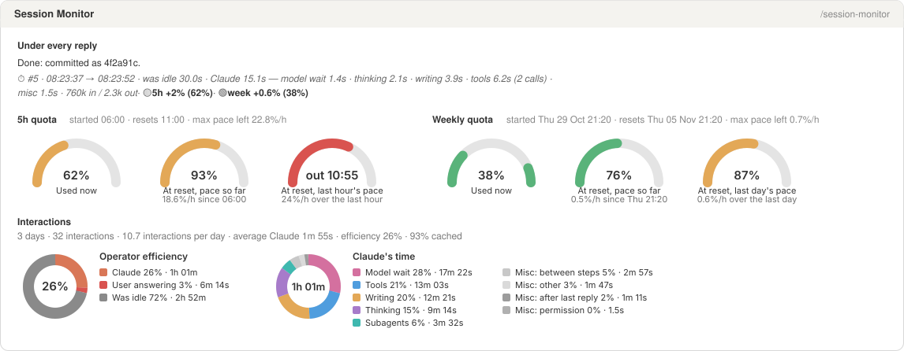
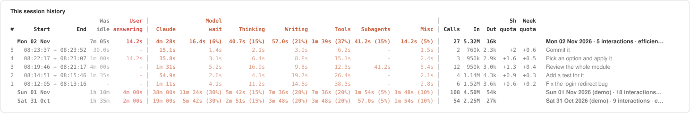
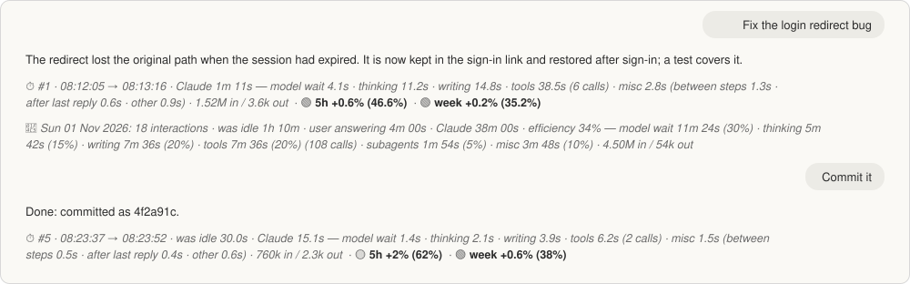

# claude stuff

Custom connectors, plugins, mods and more for Claude development.

The repository is a Claude Code plugin marketplace (`.claude-plugin/marketplace.json`): each mod under `mods/` installs
with one line.

## Mods

### session-monitor

The Session Monitor: every interaction (a prompt and its answer) split into **Claude's time** and its parts, **your
time** (idle before it, answering during it), operator efficiency, tokens and the 5-hour and weekly quota, day by day.







*The pane is drawn from the mod's own output with a sample morning and two `demo` days; the chat shows its lines
for the same morning.*

- **Under every reply**, an italic line, numbered within the day, each quota in bold after a dot in its gauge's colour
  (🟢 under 50%, 🟡 under 80%, 🔴 above):
  `⏱ #3 · 14:02:11 → 14:03:40 · was idle 2m 10s · user answering 6.0s · Claude 1m 23s — model wait 8.1s · thinking 12.0s · writing 21.3s · tools 30.2s (5 calls) · subagents 10.0s · misc 1.4s · 312k in / 18k out ·` 🟢 **`5h +0.8% (34%)`** · 🟡 **`week +0.2% (61%)`**.
  The first reply of a new day adds the finished day's line (`📅 Sun 01 Nov 2026: 23 interactions · … · efficiency 41% — …`).
- **In the prompt footer**, a label: `⏱ last 1m 29s · today 14m 02s · 5h 34% · wk 61%` (`paused` or `stopped` when so).
- **`/session-monitor`** opens the Session Monitor pane:
  - **5h quota** and **Weekly quota**: a row each, with when the window started and when it resets, and its max pace left
    (the %/h that would just reach 100% at the reset), then three gauges: **Used now**; **At reset, pace so far**
    (the pace since the window started, carried on to the reset); **At reset, last hour's pace** (the last day's for
    the week). Each is green, amber from 80%, or red with `out HH:MM` when that pace runs the window out before its
    reset; a forecast never shows less than what is used. The pace so far waits until 10% of the window has gone;
    until the readings (one a minute, kept 25 hours in the store) span 20 minutes (4 hours for the week), the last
    gauge shows the pace so far and says `Measuring recent pace`. The terminal shows the same as text.
  - **Interactions**: days, interactions, interactions per day, Claude's average time per interaction, efficiency, the
    cached share of input tokens; then two charts (desktop): **Operator efficiency** (Claude, user
    answering, was idle) and **Claude's time** (its parts, largest first, misc's parts in a second legend column), shown from the start with every slice
    at 0s until the first answer ends; while an interaction runs they are redrawn at most every 5 seconds. Pointing at a slice, or at its legend row, thickens the slice, fades the others
    and highlights the row.
  - **This session history**: a table in three groups set off by bars: `# · Start → End · Was idle · User answering`
    (grey and red), then in Claude's orange `Claude · Model wait · Thinking · Writing · Tools · Subagents · Misc`
    (**Claude**, in bold, is the sum of the others), then `Calls · In · Out · 5h quota · Week quota` (what each
    interaction moved the window). Headers take two lines to keep columns narrow. Today's summary row (its date in
    Start, each part with its share of Claude's time) heads today's interactions, newest first; each earlier day is
    one summary row. At most 100 interactions are kept; a day is never dropped, only reduced to its summary.
  - **Earlier sessions**: the five most recent (the last 50 are kept, in the mod's own store).

| Command | Does |
| --- | --- |
| `/session-monitor` | Opens the Session Monitor |
| `/session-monitor startday` | Starts a new day now: idle is measured from now, numbering starts again at #1 |
| `/session-monitor stopday` | Closes the day: idle isn't counted until `startday` or the first prompt after 05:00 |
| `/session-monitor pause` | A break: idle isn't counted until the next prompt |
| `/session-monitor reset` | Wipes everything: all days and the earlier sessions' history |
| `/session-monitor demo` | Adds two made-up earlier days, marked `(demo)`, to see the multi-day view; `demo off` removes them |
| `/session-monitor version` | Shows the installed version |
| `/session-monitor help` | Lists these |

**The command's name is a setting** (`commandName`, default `session-monitor`), so you can give it your own prefix:
in the config menu, or in `~/.claude/settings.json`:

```json
"pluginConfigs": { "session-monitor@claude-stuff": { "options": { "commandName": "cbo-session-monitor" } } }
```

How an interaction's wall time is split: on the main loop, each moment goes to one part, the first that holds:
**user answering** (`AskUserQuestion`, `ExitPlanMode` open), else **tools** (any tool running; parallel calls count
once), else **subagents** (an `Agent` tool running), else the model step's state: **model wait** (request sent,
nothing streamed back yet), **thinking**, **writing** (visible text or a tool call's arguments streaming).
**Claude** = the wall time less user answering; **misc** is what Claude's parts leave: the engine's own work between
steps (building the request, hooks, the turn's start and end, a tool call's permission decision). A subagent's own
tokens and tool calls are added to the interaction.

*Experiment (since 0.7, may be rolled back):* misc is broken down as measured: **permission** (from a tool call's
permission check until the tool starts: the auto-mode classifier, or a permission dialog the person answers),
**between steps**, **after last reply**, and **other** for the rest (the engine's start of the turn included). It
shows in the line under each reply (`misc 2.8s (permission 1.5s · between steps 0.2s · …)`) and as grey slices of the
Interactions chart; the table keeps a single Misc column.

**Was idle** is the gap since the previous answer or `startday` (a break, from `pause` to the next prompt, is left out; time on `/compact` or
another local command falls in it). A day runs from 05:00 to 05:00 local: a late night belongs to the day before; the
first prompt after 05:00 opens a new day, with no idle. While a day is stopped, idle is not counted.
**Operator efficiency** = Claude / (Claude + user answering + was idle): high when Claude works and the person
answers quickly and relaunches. Days are this session's.

Where it is kept: the days and interactions live in the session's state while it runs, with a snapshot in the mod's
store (a JSON file under `~/.claude/plugins/store/`) after each interaction and command, so a session resumed after
the app restarts gets them back; the store also keeps the last 50 sessions' summaries, and snapshots only for those.

Tokens are summed over every model request, subagents' included: "in" holds cache reads and writes. The quota is the
account's, as the status line reads it (a subscription only, one decimal): its move over an interaction counts other
sessions running meanwhile, and a window that reset during it shows where it stands alone. The line under a reply
only changes what is drawn; the transcript is left as it was.

## Install

One line in a shell, then restart Claude (user scope: every new session loads the mod):

```bash
claude plugin marketplace add christobaldo/claude-stuff && claude plugin install session-monitor@claude-stuff --scope user
```

Or at the prompt of a terminal session: `/plugin marketplace add christobaldo/claude-stuff`, then
`/plugin install session-monitor@claude-stuff` and Enter for the user scope. In the desktop app, where `/plugin` does
not run: click **+** next to the prompt box, then **Plugins**, **Add marketplace** with `christobaldo/claude-stuff`,
then **Add plugin**.

Sessions already open pick a mod up when restarted. To update after a new version:

```bash
claude plugin marketplace update claude-stuff
```

```bash
claude plugin update session-monitor@claude-stuff
```

Installing from a private copy (a private fork, say) needs a git credential for github.com first (an SSH key, or
`gh auth login` then `gh auth setup-git`); the install never prompts for one.

## Developing a mod

Each mod is a hooks module (`hooks/register.tsx`) with its manifest (`.claude-plugin/plugin.json`), its state contract
(`types/index.d.ts`) and tests (`tests/`). The engine writes the API types into `.claude-plugin/types/` the first time it
loads the mod (ignored by git); `tsconfig.json` extends them.

```bash
claude plugin validate mods/session-monitor
```

```bash
claude plugin test mods/session-monitor
```

To try changes live without installing, start a session with `claude --plugin-dir mods/session-monitor`.

## For Claude: installing a mod for your user

When your user asks you to install a mod from this repository (for example "install session-monitor from
christobaldo/claude-stuff"):

1. **Check the tools.** `claude --version` must work (Claude Code is installed) and `git` must be on the path. Nothing
   needs cloning: Claude Code fetches the repository itself.
2. **Install at user scope**, so every new session loads it. In a shell:

   ```bash
   claude plugin marketplace add christobaldo/claude-stuff && claude plugin install session-monitor@claude-stuff --scope user
   ```

   If the marketplace is already added, run `claude plugin marketplace update claude-stuff` instead of the first half.
   If the user wants their own command name, add `--config commandName=<name>` to the install (letters, digits, `-`
   and `_`; the default is `session-monitor`).
3. **No shell?** In a terminal session the user can type `/plugin marketplace add christobaldo/claude-stuff`, then
   `/plugin install session-monitor@claude-stuff`. In the desktop app: **+** next to the prompt box, **Plugins**,
   **Add marketplace** (`christobaldo/claude-stuff`), then **Add plugin**.
4. **Ask the user to restart** Claude (the app, or the terminal session): open sessions load a new mod only when they
   start.
5. **Check it works** in the new session: the first reply gets a `⏱ #1 · …` line under it, and `/session-monitor`
   (or the chosen name) opens the pane; `/session-monitor version` names the installed version.

Updating later: `claude plugin marketplace update claude-stuff`, then
`claude plugin update session-monitor@claude-stuff`, then a restart. Removing: `claude plugin uninstall
session-monitor@claude-stuff`. If an install fails, check the marketplace name and the network first; a private copy
of the repository also needs a git credential for github.com (`gh auth login`, then `gh auth setup-git`).

Changing a mod here: edit `mods/<mod>/`, run validate and test (above), bump `version` in its `plugin.json`, commit;
push only with the owner's yes.

## Contact

christobaldo.cbo@gmail.com, or an issue on this repository.

## License

[MIT](LICENSE)
